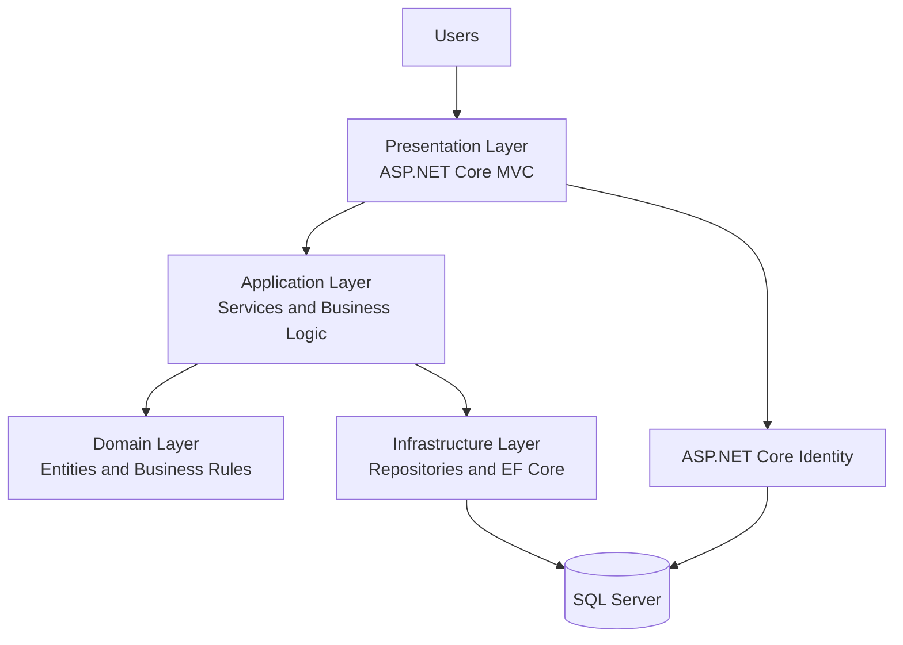
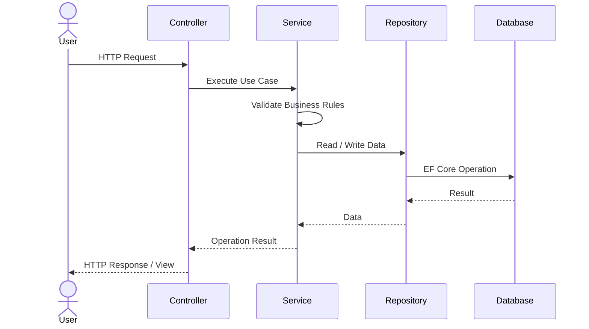
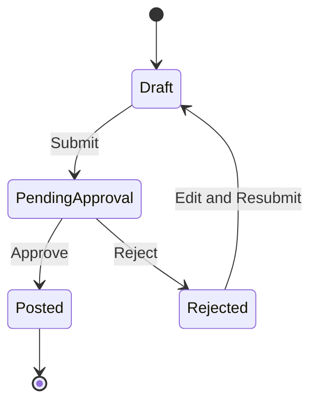

# Orvanta – Architecture Overview

## 1. Introduction

Orvanta is a business management system designed for medium-sized trading companies.

The system follows a **Layered Monolithic Architecture** using ASP.NET Core MVC, Entity Framework Core, and SQL Server.

The architecture separates presentation, business logic, and data access responsibilities to improve maintainability, testability, and scalability.

## 2. Architecture Style

**Selected Architecture: Layered Monolithic Architecture**

The application is deployed as one application but internally organized into separate logical layers.

### Main Layers

1. Presentation Layer
2. Application Layer
3. Domain Layer
4. Infrastructure Layer

## 3. High-Level Architecture

## 4. Layer Responsibilities

### 4.1 Presentation Layer

**Technology:** ASP.NET Core MVC, Razor Views, HTML, CSS, JavaScript.

Responsibilities:
- Handle HTTP requests and responses.
- Display application pages and forms.
- Validate incoming user input.
- Manage navigation between screens.
- Apply authentication and authorization requirements.
- Call application services to execute operations.

Controllers must not contain complex business logic or direct database operations.

### 4.2 Application Layer

Responsibilities:
- Coordinate application use cases.
- Implement business operations through services.
- Enforce business rules.
- Coordinate repositories.
- Manage transaction boundaries for critical operations.
- Handle approval and posting workflows.
- Return appropriate results to controllers.

Examples:
- SalesInvoiceService
- PurchaseInvoiceService
- InventoryService
- CustomerReceiptService
- SupplierPaymentService
- ExpenseService
- ReportingService

### 4.3 Domain Layer

Responsibilities:
- Define core business entities.
- Represent business concepts and relationships.
- Contain domain-related rules where appropriate.
- Define enums and shared domain types.

Examples:
- Product
- Customer
- Supplier
- Warehouse
- InventoryStock
- InventoryTransaction
- SalesInvoice
- PurchaseInvoice
- CustomerReceipt
- SupplierPayment
- Expense

The Domain Layer must not depend on ASP.NET Core MVC, EF Core, or SQL Server.

### 4.4 Infrastructure Layer

Responsibilities:
- Implement database access.
- Configure Entity Framework Core.
- Implement repositories.
- Manage database migrations.
- Integrate ASP.NET Core Identity with SQL Server.
- Provide persistence-related implementations.

Examples:
- ApplicationDbContext
- Repository implementations
- Entity configurations
- Database migrations
- Identity persistence configuration

## 5. Dependency Direction

The application follows these dependency principles:

- Presentation depends on Application.
- Infrastructure implements persistence requirements used by Application.
- Application depends on Domain.
- Domain remains independent of the other layers.

Infrastructure dependencies are registered through Dependency Injection.

## 6. Request Processing Flow

Typical request flow:

## 7. Business Transaction Management

Critical business operations must execute within database transactions.

Examples:
- Posting a sales invoice.
- Posting a purchase invoice.
- Posting a customer receipt.
- Posting a supplier payment.
- Voiding a posted receipt or payment.
- Posting an expense.

A transaction ensures that related database changes succeed or fail together.

For example, posting a sales invoice must coordinate:
- Updating warehouse stock.
- Creating inventory transactions.
- Calculating cost of goods sold.
- Updating invoice status.
- Recording approval/posting information.

If any critical operation fails, the transaction must be rolled back.

## 8. Authentication and Authorization

Orvanta uses ASP.NET Core Identity.

Authentication:
- User login and logout.
- Password management.
- User account management.

Authorization:
- Identity Roles.
- Authorization Policies.
- Controller and action-level authorization.
- Service-level authorization for sensitive operations.

Roles:
- Admin
- Manager
- Accountant
- SalesEmployee
- WarehouseEmployee

Sensitive operations must be protected at the application/service level, not only by hiding interface elements.

## 9. Inventory Architecture

Inventory is tracked separately for each warehouse.

The system uses:
- InventoryStocks to store current stock and average cost.
- InventoryTransactions to maintain stock movement history.
- Weighted Average Costing (WAC) per warehouse.

Stock changes are generated by approved and posted business operations.

Manual stock adjustments are not supported in the MVP. Opening balances are the initial inventory entry mechanism.

## 10. Invoice Lifecycle Architecture

Sales and purchase invoices follow this lifecycle:

Business constraints:
- The invoice creator cannot approve their own invoice.
- Approval must be performed by another authorized user.
- Rejection requires a reason.
- Approval history is preserved.
- Posted invoices are immutable in the MVP.

## 11. Reporting Architecture

Reporting services retrieve and aggregate data from the application database.

Reports include:
- Sales reports.
- Purchase reports.
- Inventory reports.
- Customer balances.
- Supplier balances.
- Expense reports.
- Estimated profit reports.

Financial reports are administrative and operational reports, not a full accounting or general ledger system.

## 12. Scalability and Maintainability

The architecture supports future improvements through:
- Independent service responsibilities.
- Repository abstractions where useful.
- Dependency Injection.
- Centralized business rules.
- Database indexing and query optimization.
- Background processing when required.
- Automated testing.

The MVP remains a single deployable application. Future architectural changes should be based on actual performance or business requirements.

## 13. Summary

Orvanta uses a Layered Monolithic Architecture to maintain a clear separation of responsibilities while avoiding unnecessary infrastructure complexity.

The architecture is designed to support reliable business workflows, inventory accuracy, controlled invoice approval, and maintainable future development.